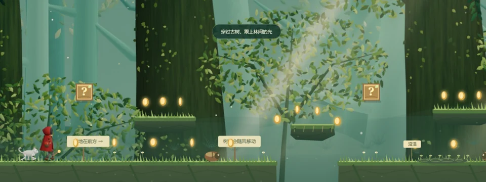
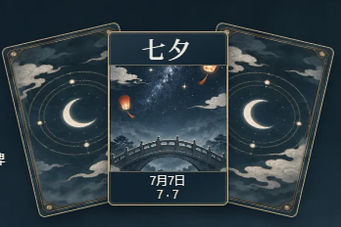
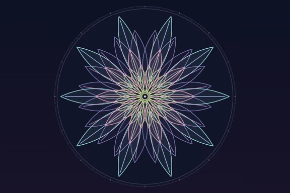

创意编程、网页游戏和互动作品。

## 作品选集

### 风野奇旅 · 守望之境

带着白猫穿越草原、古树、海岛和洞窟的 2.5D 横版冒险。 
**[在线试玩](https://zjh-b.github.io/windward-trails/)** · [源码](https://github.com/zjh-b/windward-trails)

<table role="presentation">
  <tr>
    <td width="50%" valign="top">
      
       
      <strong>朔望月 · 八手之间</strong> 
      用节气牌推断隐藏规则的网页卡牌游戏。 
      <a href="https://zjh-b.github.io/shuowangyue/">在线试玩</a> · <a href="https://github.com/zjh-b/shuowangyue">源码</a>
    </td>
    <td width="50%" valign="top">
      
       
      <strong>Turtle Gallery</strong> 
      Python Turtle 与 Tkinter 绘画、动画和互动作品。 
      <a href="https://zjh-b.github.io/turtle-gallery/">逛画廊</a> · <a href="https://github.com/zjh-b/turtle-gallery">源码</a>
    </td>
  </tr>
</table>

[浏览全部仓库 →](https://github.com/zjh-b?tab=repositories)

## 贡献日历

<picture>
  <source media="(prefers-color-scheme: dark)" srcset="./github-snake-dark.svg">
  
</picture>
