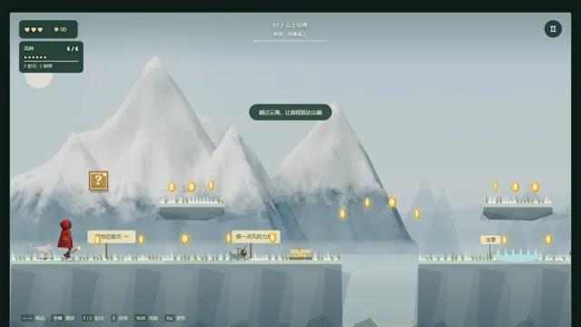
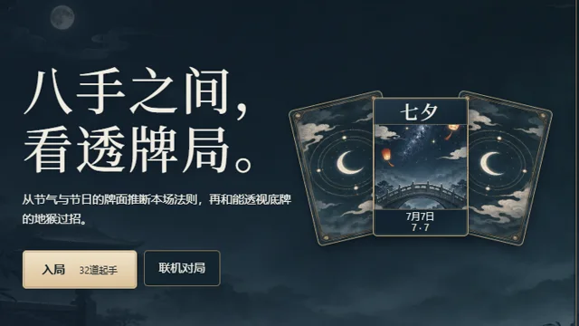
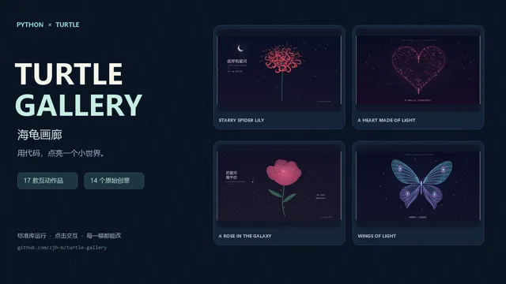

创意编程、网页游戏和互动作品。

## 作品选集

<table>
  <tr>
    <td width="40%" valign="middle">
      
    </td>
    <td width="60%" valign="middle">
      <strong>风野奇旅 · 守望之境</strong> 
      和白猫一起穿越草原、海岛和洞窟的 2.5D 横版冒险。 
      <a href="https://zjh-b.github.io/windward-trails/">在线试玩</a> · <a href="https://github.com/zjh-b/windward-trails">源码</a>
    </td>
  </tr>
  <tr>
    <td width="40%" valign="middle">
      
    </td>
    <td width="60%" valign="middle">
      <strong>朔望月 · 八手之间</strong> 
      用节气牌推断隐藏规则的网页卡牌游戏。 
      <a href="https://zjh-b.github.io/shuowangyue/">在线试玩</a> · <a href="https://github.com/zjh-b/shuowangyue">源码</a>
    </td>
  </tr>
  <tr>
    <td width="40%" valign="middle">
      
    </td>
    <td width="60%" valign="middle">
      <strong>Turtle Gallery</strong> 
      用 Python Turtle 和 Tkinter 创作的 24 个绘画、动画与互动作品。 
      <a href="https://github.com/zjh-b/turtle-gallery">浏览项目</a>
    </td>
  </tr>
</table>

[浏览全部仓库 →](https://github.com/zjh-b?tab=repositories)

## 贡献日历

<picture>
  <source media="(prefers-color-scheme: dark)" srcset="./github-snake-dark.svg">
  
</picture>
